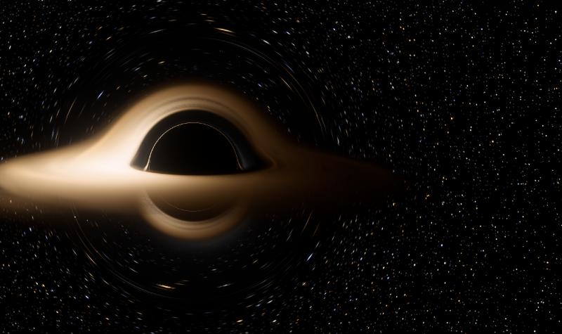
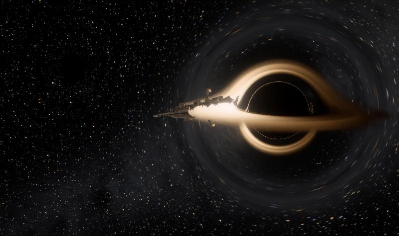
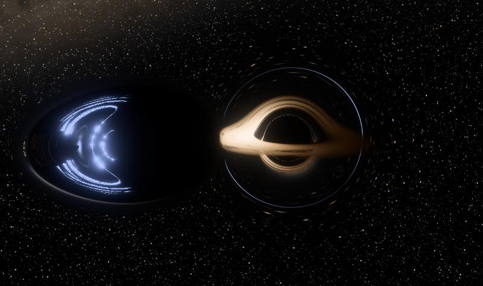

# Event Horizon

Three black hole simulators that run live in the browser. Every pixel's light is traced through Einstein's equations on your graphics card, every frame.

**[Open the gallery →](https://drjoetruax.github.io/event-horizon/)**

| | |
|---|---|
| [](https://drjoetruax.github.io/event-horizon/event-horizon/) | **[Event Horizon](https://drjoetruax.github.io/event-horizon/event-horizon/)**<br>Fly around a black hole, still (Schwarzschild) or spinning (Kerr). The accretion disk's color is a blackbody temperature, shifted by gravity and by the gas's own speed, so the side coming toward you blazes and the far side's light bends up over the shadow. |
| [](https://drjoetruax.github.io/event-horizon/recomposition/) | **[The Recomposition](https://drjoetruax.github.io/event-horizon/recomposition/)**<br>A mothership climbs back out of a black hole and reassembles. It's real spaghettification played backward: 2,016 pieces of the ship each fall on their own exact orbit, and each one appears where its light actually reaches you. There's a Faithful version and a Stylized one. |
| [](https://drjoetruax.github.io/event-horizon/warp-strike/) | **[Warp Strike](https://drjoetruax.github.io/event-horizon/warp-strike/)**<br>A warp bubble as big as the black hole comes at it faster than light. It outruns its own light, so it appears out of nowhere as two images, one flying forward and one flying backward. Light is traced through the bubble's warped spacetime laid over the black hole's. |

## What's computed

- **Light paths.** Schwarzschild rays integrate the orbit equation u″ = 1.5u² − u. Kerr rays integrate the full geodesic equations in Boyer–Lindquist coordinates, using Mino time, as seen by a zero-angular-momentum observer.
- **Disk light.** A Novikov–Thorne-style temperature profile goes through a blackbody table. Each crossing applies the frequency shift g, from gravity and Doppler together, along with relativistic beaming.
- **Tidal disruption** (The Recomposition). Each piece of the ship follows its own timelike geodesic, with the distant observer's clock tracked along it. A table of exact light paths places every piece on screen, including the secondary image around the far side of the hole.
- **Warp metric** (Warp Strike). Painlevé–Gullstrand flow plus an Alcubierre bubble, ds² = −dt² + |dx − V dt|². Light is traced backward in time with the Hamiltonian H = ½(|p|² − (p_t + V·p)²).

Each simulator has a **What's real** panel that marks where the physics ends and the storytelling begins. Nothing comes out of a real black hole, and no known matter can make a warp bubble.

## Running it

The pages need no build or server. Open any `index.html` in a browser with WebGL2. A dedicated GPU keeps it smooth; on integrated graphics the resolution drops to keep up.

To work on the source:

```bash
python build.py            # rebuilds the three pages from src/
python -m http.server 8765 # then open http://localhost:8765/
```

`src/*.src.html` are the page sources. Shared shader code lives in `src/_part_*.js` and is pulled in wherever a source says `/*@name@*/`.

---

Made by [DrJoeTruax](https://github.com/DrJoeTruax) with Claude.
